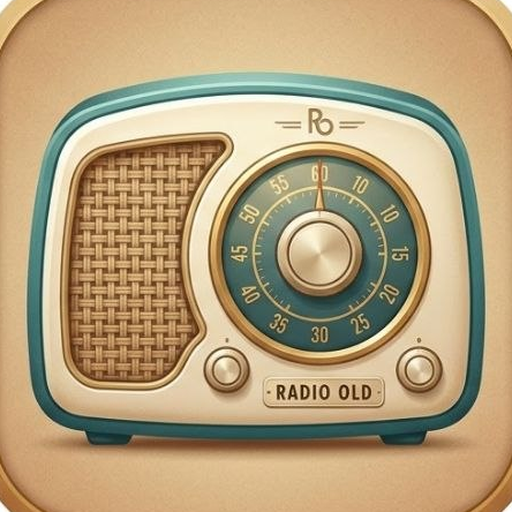
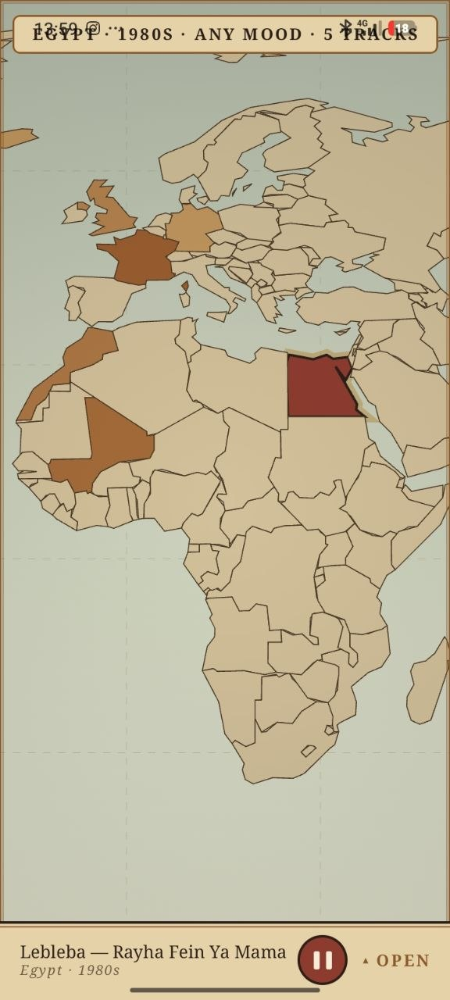
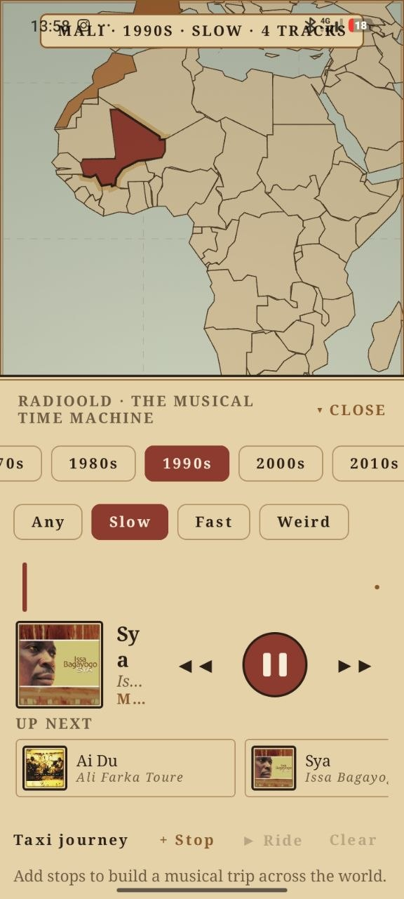
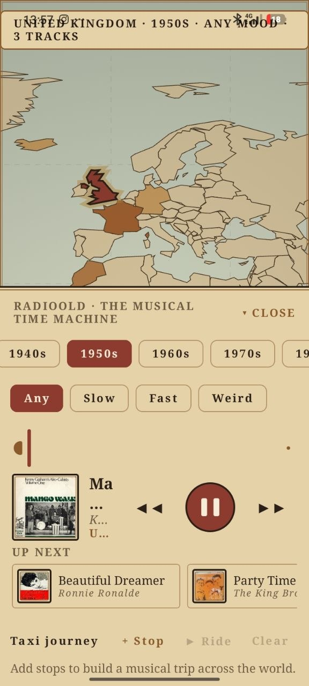
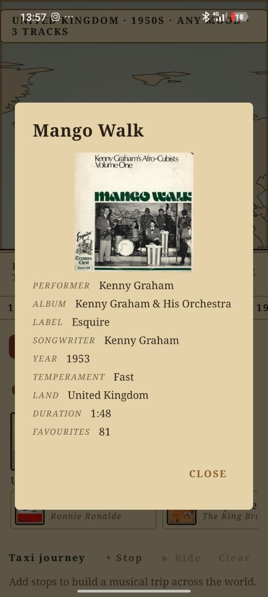
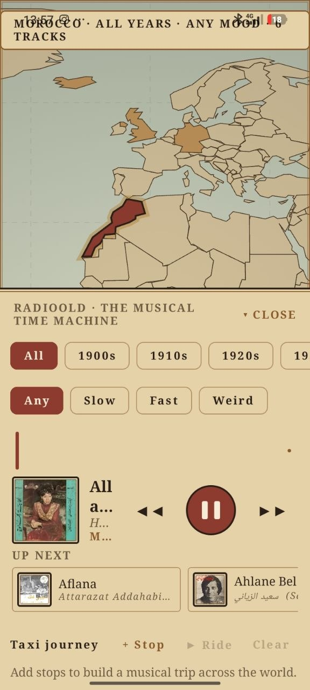
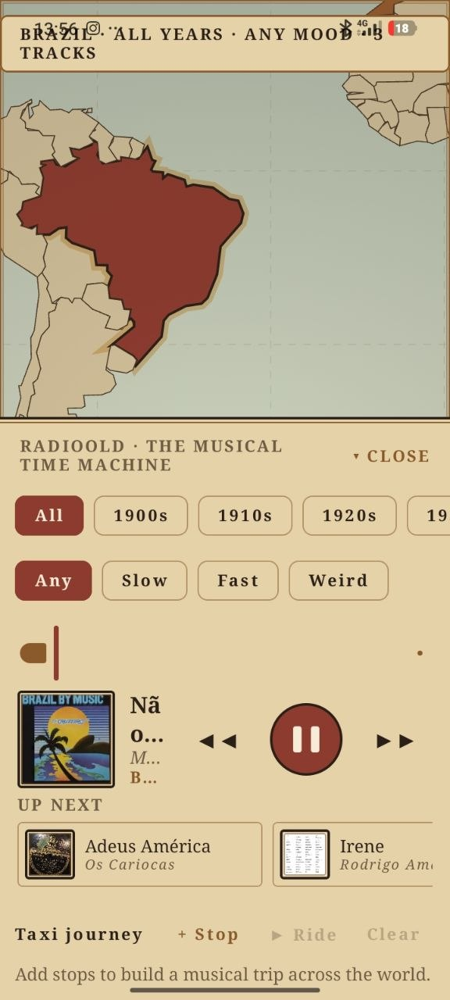

<div align="center">



# Radioold — a musical time machine

**An Android app that plays real music by place and time**: pick a country on the
world map, pick a decade, pick a mood, and travel through music. A clean-room
alternative to [radiooooo.com](https://radiooooo.com).

[](LICENSE)
[](https://github.com/eyoussef/radioold/releases)
  

| 🗺️ Antique world map | 🕰️ 1900s → 2010s | 🎭 Any / Slow / Fast / Weird |
|---|---|---|
| **🎧 Background playback** | 🚕 Taxi mode — multi-stop journeys | 🔀 Fresh shuffle, every time |

</div>

## Screenshots

| Map & decades | Radio streaming | Taxi journey |
|---|---|---|
|  |  |  |
|  |  |  |

## Install

Grab the signed APK from the
[latest release](https://github.com/eyoussef/radioold/releases/latest), or install
Radioold through your favourite GitHub app store:

- [Komi Store](https://komistore.app/) — search "radioold"
- [RepoStore](https://repostore.in/) — search "radioold"

Or build it yourself (JDK 17+, Android SDK with platform 37):

```bash
git clone https://github.com/eyoussef/radioold.git
cd radioold
gradle :app:assembleRelease
```

> The release build comes out unsigned; sign it with your own keystore, or just
> open the project in Android Studio and press **Run** to install it directly.

## Usage

1. Pick a **country** on the antique map (pinch to zoom, drag to pan).
2. Pick a **decade** — 1900s through 2010s, plus **Now**.
3. Pick a **mood** — Any / Slow / Fast / Weird.
4. Press the wax seal to play. The music of that place and time streams in; the
   player folds into a mini bar so the map stays full-screen.

## What it does

- **World map** — 180 countries on a Compose canvas, with **pinch-zoom + drag-pan**.
  Countries are coloured by how much music they have; tap to tune in. Drawn like
  an **antique chart**: parchment sea, sepia washes, ink coastlines, dashed
  graticule, wax-seal red for the selected land.
- **Decade selector** — 1900s through 2010s, plus "Now".
- **Mood** — Any / Slow / Fast / Weird.
- **Station fetch** — selecting a country and decade **calls the sources** for
  exactly that selection when the local catalog is thin, then starts playing.
- **Random radio** — every country/decade/mood selection plays in a **fresh shuffled
  order** (never the catalog order twice, never restarting the playing track).
- **Player** — a vintage card: cover art framed like an old photograph (**tap the
  cover to open the record's full liner notes** — album, label, songwriter,
  year, mood, duration, favourites), serif captions, a wax-seal play/pause disc,
  crossfading transitions, and an **Up next** rail. The whole app is aged paper,
  brown ink and brass — made to feel like something kept in a history drawer.
- **Collapsible panel** — years, moods and player live in a bottom panel that
  folds into a slim mini player, leaving the map the whole screen.
- **Background playback** — the player runs in a media service: the station
  keeps playing when you leave the app or lock the phone, with system
  notification controls.
- **Taxi mode** — build a multi-stop journey across countries and decades; stops
  play in journey order, tracks random within each stop.

## Music — radiooooo.com

The music comes from **the same source as [radiooooo.com](https://radiooooo.com)**
— the original musical time machine. Its station API serves one random track per
call from a curated **country × decade × mood** catalog: real local music of the
selected year, full MP3 audio, and full metadata (artist, title, album, label,
songwriter, year, mood, cover art).

| Piece | Role |
|---|---|
| `RadioooooApi` | `POST /play` (station) and `/play/random` (worldwide) — one random track per call |
| Queue feeding | small just-in-time queues: the signed stream links expire in ~15 minutes, so fresh tracks are fetched as the current ones are consumed |
| Empty stations | an area/decade without music stays silent — exactly what radiooooo itself reports ("This Area/Decade is EMPTY for now") |

Pick a country and a decade and the station plays that place and time — it is
the radiooooo catalog itself, not an approximation.

## Architecture

Kotlin + Jetpack Compose (Material 3), single module, manual DI.

| Layer | Responsibility |
|---|---|
| `data/remote` | `RadioooooApi` — radiooooo station API (random track per call, direct MP3 links) |
| `data/catalog` | `CatalogRepository` — station queues fed just in time |
| `data/geo` | world-map geometry + point-in-polygon hit-testing |
| `domain` | pure logic: filtering, random queue order (JVM unit-tested) |
| `playback` | Media3/ExoPlayer controller with fade transitions; dead streams are skipped |
| `ui` | theme, world-map canvas (zoom/pan), decade/mood/player/taxi controls |

The `domain` layer is pure Kotlin (no Android imports) and unit-tested on the JVM.

```bash
gradle :app:testDebugUnitTest    # run the JVM unit tests
```

## Tools

- `tools/build_worldmap.py` — converts country polygons into `assets/world.json`
  (simplified + normalized equirectangular) for the map canvas.

## Honest limitations

- **radiooooo's API is private** (no public API program): it works keyless today,
  but they can change, rate-limit or auth-gate it. Radioold is a clean-room
  client; if it breaks, `RadioooooApi` is the one place to fix.
- Stream links are signed and expire in ~15 minutes — queues are deliberately
  small and topped up just in time.
- Some country/decade cells are genuinely empty in the radiooooo catalog; those
  stations go silent rather than playing the wrong music.
- "Crossfade" is a smooth volume fade at track boundaries (single player).
- Lock-screen/notification controls are the system defaults from the media
  session; no custom media styling yet.

## License

[MIT](LICENSE). Radioold is a clean-room project — no code from radiooooo.com.
Music and cover art belong to their owners and radiooooo.com's catalog; this
project merely streams it for personal listening and claims no rights over it.